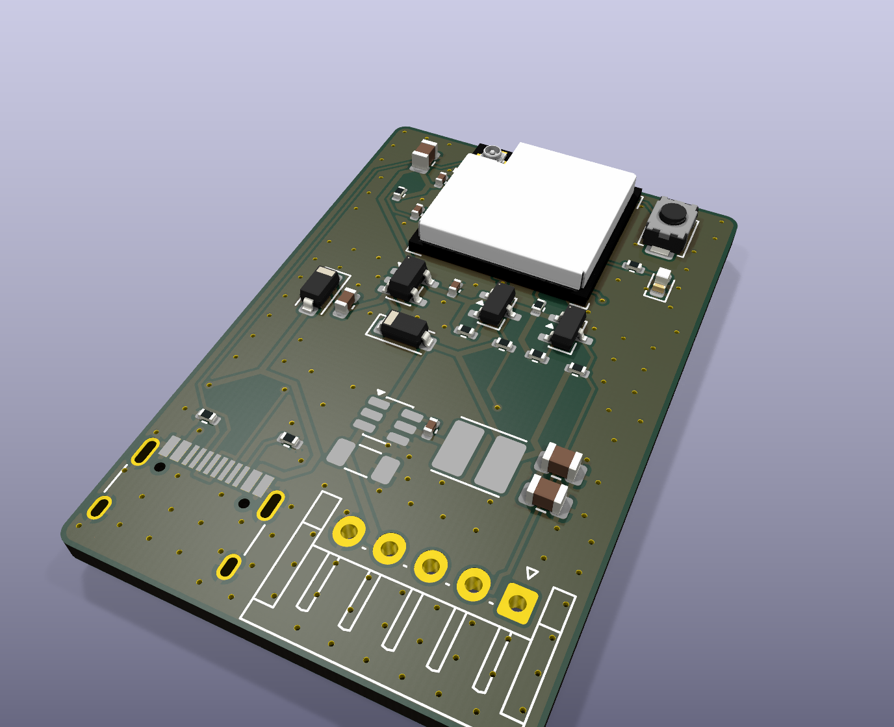

# Breeze voor Daikin: print `daikin-c6`

Onderdeel van [Nerdhome Breeze](../README.md). Firmware: [`esphome/breeze-daikin.yaml`](../esphome/breeze-daikin.yaml).

Printje van 28 × 42 mm voor de **S21-aansluiting** van Daikin-binnenunits (Emura, Perfera, Stylish, Sensira, Comfora en andere huishoudelijke splitunits). Het zet de unit lokaal via ESPHome in Home Assistant, met het component [esphome-daikin-s21](https://github.com/asund/esphome-daikin-s21) (UART 2400 baud, 8E2). Commerciële systemen met P1/P2 (Sky Air, VRV, Altherma) vallen hier niet onder.

**Status: revisie 1.0, nog niet in hardware getest.** ERC en DRC (met schema-pariteit) zijn schoon en de footprints zijn uitgelijnd tegen JLCPCB's eigen footprints. Test eerst één bordje op één unit.

## Verschil met de Toshiba-print

Zelfde basis: ESP32-C6-MINI-1U met U.FL-antenne, AP2112K 3,3 V-regelaar, Schottky-OR met USB-C, twee AO3400A-niveau-omzetters, BOOT-knop en status-LED, dezelfde GPIO's (19 = TX, 20 = RX, 23 = LED).

| | Toshiba (`toshiba-c6`) | Daikin (`daikin-c6`) |
|---|---|---|
| Aansluiting | CN22, JST PA 2,0 mm | S21, JST EH 2,5 mm (S5B-EH, zijingang) |
| Voeding uit de airco | 5 V | 12–15 V op pin 4 → buck-converter AP63205 → 5 V |
| Pull-ups datalijnen | op de 5 V van de airco | op de eigen 5 V van de buck (Daikin-lijnen zijn open drain) |
| UART | 9600 8E1 | 2400 8E2 |
| Afmeting | 24 × 34 mm | 28 × 42 mm (EH-connector en USB-C passen niet samen op 24 mm) |

## Aansluiting J1 (Daikin S21)

| Pin | Functie | Op de print |
|---|---|---|
| 1 | Vref 5 V (referentie, soms afwezig) | **niet aangesloten** |
| 2 | TX van de airco | ESP RX (GPIO20) via Q2 |
| 3 | RX van de airco | ESP TX (GPIO19) via Q1 |
| 4 | Vcc 12–15 V | voeding via buck U3 |
| 5 | GND | GND |

Kabel: EHR-5 aan beide kanten, pin 1 op pin 1 (1-op-1). Sommige units hebben een JST PAP-aansluiting (2,0 mm) in plaats van EH; dan heb je een PAP-naar-EH-kabel nodig. Meet vóór het insteken pin 4 tegen pin 5: daar hoort 12–15 V te staan.

## Bestellen bij JLCPCB

Zoals bij de Toshiba-print: upload `production/daikin-c6_gerbers_jlcpcb.zip` (2 lagen, 1,6 mm), zet PCB Assembly aan voor de bovenkant en upload `production/daikin-c6_bom_jlcpcb.csv` en `production/daikin-c6_cpl_jlcpcb.csv`. Controleer in de plaatsingsvoorbeeldweergave vooral U3 (buck), U2, Q1/Q2, D1/D2 (streep = kathode), D3 en de richting van J1 (opening naar de onderrand).

Extended parts: U1, U2, U3 (AP63205WU-7), L1 (4,7 µH), J1 (S5B-EH), J2 en SW1.

## Veiligheid

- Sluit nooit USB aan terwijl het bordje aan de airco hangt.
- Werk alleen aan de binnenunit met de stroom eraf.
- Gebruik nooit de S403-aansluiting met pin 10: daar staat ongeveer 327 V DC op.

## Bestanden en opnieuw genereren

Zelfde opbouw als `toshiba/`: `hardware/` (KiCad 9), `production/` (JLCPCB), `docs/` (schema-PDF, assemblagetekening, renders), `tools/` (generatoren; `tools/circuit.py` is de enige bron voor onderdelen en netten, `tools/build_pcb.sh` en `tools/gen_outputs.sh` bouwen alles opnieuw).
