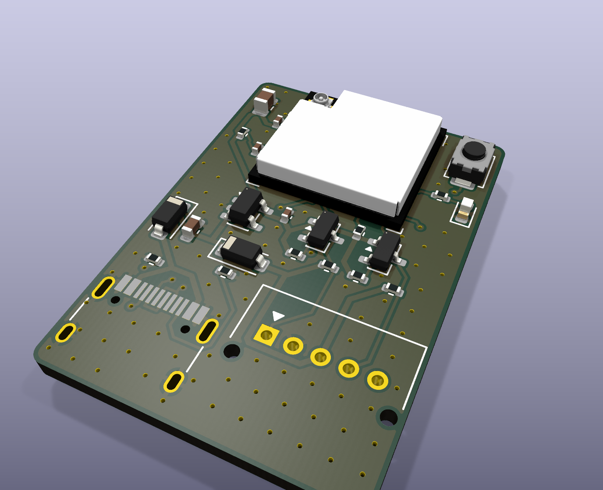

# Breeze voor Toshiba: print `toshiba-c6`

Onderdeel van [Nerdhome Breeze](../README.md). Firmware: [`esphome/breeze-toshiba.yaml`](../esphome/breeze-toshiba.yaml).

Klein printje (24 × 34 mm) dat de originele Toshiba wifi-module (RB-N10x) vervangt en de binnenunit lokaal via ESPHome in Home Assistant zet. Het praat via connector CN22 met de binnenunit, op 5 V UART, 9600 baud, 8E1. Dat is hetzelfde protocol dat [esphome_toshiba_suzumi](https://github.com/pedobry/esphome_toshiba_suzumi) en [esphome-toshiba-hvac-controller](https://github.com/florianbrede-ayet/esphome-toshiba-hvac-controller) gebruiken.

**Status: revisie 1.0, nog niet in hardware getest.** ERC en DRC zijn schoon, het schema komt overeen met de PCB en de footprints zijn uitgelijnd tegen JLCPCB's eigen footprints. Bestel eerst een kleine batch en test één bordje voordat je alle binnenunits ombouwt.

## Wat zit erop

| Onderdeel | Keuze | Waarom |
|---|---|---|
| MCU | ESP32-C6-MINI-1U-H4 (LCSC C20627095) | Wifi 6, RISC-V, native USB, 105 °C-versie. De MINI-1 met printantenne is bij JLCPCB uitverkocht. |
| Antenne | U.FL-connector op de module | Losse 2,4 GHz-antenne plak je binnen in de kap, weg van het metaal |
| Voeding | AP2112K-3.3, 600 mA LDO | Gevoed vanaf CN22 pin 3 (5 V) of USB-C |
| Diode-OR | 2× B5819W Schottky | USB en airco-5 V voeden elkaar nooit terug |
| Niveau-omzetting | 2× AO3400A MOSFET-levelshifter, 10k pull-ups | 5 V ↔ 3,3 V, ruim genoeg voor 9600 baud |
| Aansluiting airco | JST PA S05B-PASK-2, zijingang (C489718) | Zelfde connector als de originele module, de kabel van CN22 past direct |
| USB-C | HRO TYPE-C-31-M-12 | Alleen voor de eerste keer flashen en loggen op de werkbank |
| Overig | BOOT-knop (GPIO9), status-LED (GPIO23), 10k pull-up op GPIO8 | |

## Aansluiting J1 (Toshiba CN22-kabel)

| Pin | Kleur (gebruikelijk) | Functie | Naar |
|---|---|---|---|
| 1 | blauw | AC RX | ESP TX (GPIO19) via Q1 |
| 2 | roze | GND | GND |
| 3 | zwart | +5 V | Voeding |
| 4 | wit | AC TX | ESP RX (GPIO20) via Q2 |
| 5 | roze | **niet aansluiten** | Open op de print |

Kleuren kunnen per unit afwijken. **Meet vóór het insteken**, met de airco aan de stroom en de kabel los: pin 2 is GND en pin 3 is +5 V.

## GPIO-overzicht

| GPIO | Functie |
|---|---|
| 19 | UART TX naar de airco |
| 20 | UART RX van de airco |
| 23 | Status-LED (actief hoog) |
| 9 | BOOT-knop (strapping pin) |
| 8 | Strapping pin, 10k pull-up |
| 12 / 13 | USB D− / D+ |

## Bestellen bij JLCPCB

1. Upload `production/toshiba-c6_gerbers_jlcpcb.zip`. Kies 2 lagen, 1,6 mm en verder de standaardopties.
2. Zet PCB Assembly aan voor de bovenkant (top side).
3. Upload `production/toshiba-c6_bom_jlcpcb.csv` en `production/toshiba-c6_cpl_jlcpcb.csv`.
4. J1 is through-hole. Laat JLCPCB hem meesolderen (standaard PCBA), of haal hem uit de BOM en soldeer de 5 pinnetjes zelf.
5. **Controleer de plaatsingsvoorbeeldweergave.** De rotaties in de CPL heb ik berekend door elke KiCad-footprint op JLCPCB's eigen EasyEDA-footprint uit te lijnen. Daarbij is de LED gematcht op kathode in plaats van op pinnummer. Let in het voorbeeld vooral op D3 (LED), D1/D2 (streep = kathode), Q1/Q2 en U2.
6. Er zijn 5 "extended parts": U1, U2, J1, J2 en SW1. De rest zijn basic parts.

Daarnaast heb je per bordje een 2,4 GHz-antenne met U.FL-/IPEX-MHF1-stekker nodig, bijvoorbeeld een flexibele printantenne van 42 × 12 mm met ±10 cm kabel (past in de antennesleuf van de behuizing).

## Firmware en installatie

Zie de [hoofd-README](../README.md#firmware). Kort: eerste keer via USB-C of de webinstaller flashen (print los van de airco), daarna updates via wifi. Zet de airco uit met de groepenschakelaar, haal de originele wifi-module eraf en steek de CN22-kabel in J1.

**Veiligheid**
- Sluit nooit USB aan terwijl het bordje aan de airco hangt. Het is niet zeker dat de logische massa van de binnenunit gescheiden is van het net.
- Pin 5 blijft altijd vrij.
- Werk alleen aan de binnenunit met de stroom eraf.

**Multi-split (zoals RAS-3M26):** je hebt één bordje per binnenunit nodig. De buitenunit kan niet tegelijk koelen en verwarmen. Als je in automatiseringen verschillende modi naar verschillende binnenunits stuurt, gaat er één in standby.

## Behuizing

`enclosure/enclosure_mount.py` (CadQuery) maakt een behuizing met de buitenmaat van de originele Toshiba-module (56 × 38 × 15 mm), zodat hij in de originele houder klikt. De airco-connector zit midden op de korte kant, de USB-C zit achter een dichte wand (alleen nodig met het deksel eraf), en de 42 × 12 mm FPC-antenne schuift in een sleuf langs de rechter lange wand, kabelkant naar binnen. Print de bodem plat en het deksel op zijn kop, zonder support. `enclosure/enclosure.py` is de oudere, compacte losse variant.

## Bestanden

| Pad | Inhoud |
|---|---|
| `hardware/` | KiCad 9-project: schema, PCB, projectregels, footprint-bibliotheek `toshiba-c6.pretty`, 3D-model module |
| `production/` | Gerbers + drill (zip), JLCPCB BOM, JLCPCB CPL |
| `docs/` | Schema (PDF), assemblagetekening (PDF/PNG), renders |
| `enclosure/` | 3D-printbare behuizing (CadQuery-bron, STEP en STL) |
| `tools/` | Scripts die alles genereren (zie hieronder) |

## Opnieuw genereren

Het hele ontwerp komt uit `tools/circuit.py`, de enige bron voor onderdelen en netten. Met `tools/build_pcb.sh` doorloop je de hele keten: footprints, schema, ERC, netlist-check, plaatsing, autorouting (Freerouting 2.1), GND-stitching en DRC met schema-pariteit. Daarna maken `tools/jlc_rotations.py` en `tools/gen_fab.py` de JLCPCB-bestanden. Daarvoor zijn KiCad 9 (`kicad-cli` en pcbnew-Python) nodig, plus Java 21 en de `jlcfootprint`-solver uit [Bouni/kicad-jlcpcb-tools](https://github.com/Bouni/kicad-jlcpcb-tools).

## Bronnen en dank

- JST PA-footprintgeometrie: overgenomen van het geproduceerde bord van florianbrede-ayet (MIT-licentie)
- Protocol en ESPHome-component: pedobry/esphome_toshiba_suzumi (GPL-3, alleen gebruikt als external component)
- ESP32-C6-MINI-1U land pattern en 3D-model: Espressif-datasheet v1.5 en officieel STEP-bestand
- CPL-rotatiesolver: Bouni/kicad-jlcpcb-tools (MIT)
